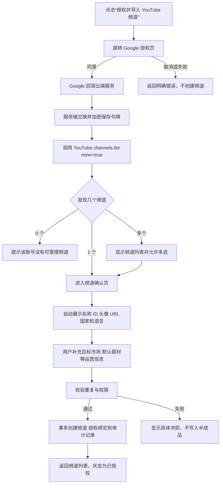

# 云端 YouTube 频道授权导入设计

日期：2026-09-14

状态：待业务确认

适用分支：`feature/tencent-cloud-deployment`

## 1. 背景与目标

当前频道创建流程要求用户先手工填写频道名称、YouTube Channel ID、语言、国家代码和时区，再对已经创建的频道执行 OAuth 授权。这一顺序不符合真实使用方式，也容易产生错误数据：频道身份信息本来可以在 Google 授权后从 YouTube Data API 获取。

本次改造目标是：

1. 云端新增频道统一改为“先授权 Google，再选择并导入 YouTube 频道”。
2. 一个 Google 账号管理多个 YouTube 频道时，允许一次授权、多选导入。
3. YouTube 能提供的频道身份数据自动获取；用户只补充系统自己的运营信息。
4. 目标国家/地区从标准列表选择，并自动带出国家代码、推荐语言和推荐时区。
5. OAuth 密钥和令牌只保存在云端服务端，浏览器和数据库均不保存明文令牌。
6. Studio 本地部署的现有功能、数据库和授权流程保持不变。

## 2. 范围边界

### 本期包含

- 腾讯云部署的 Google Web OAuth。
- OAuth 回调后发现当前 Google 账号可管理的 YouTube 频道。
- 单选或多选频道导入。
- 频道身份字段自动填充。
- 目标市场、默认题材等运营字段补充。
- 云端 OAuth 凭证加密存储、刷新与撤销状态处理。
- 租户隔离、权限校验、审计记录和自动化测试。

### 本期不包含

- 不改变 Studio 本地部署的现有行为。
- 不迁移或同步 Studio 数据到腾讯云。
- 不开发排期、频道分析、运营包生成等 AI 功能。
- 不允许用户自主注册公司或账号。
- 不引入收费、套餐和用量结算逻辑。
- 不通过第三方国家信息 API 获取国家、语言或时区。

## 3. 用户流程

## 4. 字段归属

### 4.1 YouTube 自动获取

授权成功后，服务端通过 YouTube Data API 获取并保存：

- YouTube Channel ID。
- 频道原始名称。
- 频道头像。
- 频道说明。
- 自定义 URL（存在时）。
- 标准频道 URL。
- YouTube 频道关联国家/地区（存在时）。
- YouTube 默认语言（存在时）。
- uploads playlist ID。

这些字段不再要求用户首次创建时手工录入。YouTube 未返回国家或默认语言时，不阻止导入。

### 4.2 用户补充的运营信息

- 运营简称：可选；默认使用 YouTube 频道名称。
- 目标国家/地区：必选；表示内容运营市场，不等同于 YouTube 频道关联国家。
- 默认题材：必选或沿用现有业务规则。
- 默认语言：根据目标市场推荐，用户可修改。
- 时区：根据目标市场推荐，用户可修改。
- 其他排期或发布策略：留给后续业务功能，不在本期新增。

### 4.3 国家、语言和时区联动

前后端共用一份版本化国家目录，至少包含：

- ISO 3166-1 alpha-2 国家代码。
- 中文国家名称。
- 推荐内容语言。
- 推荐时区列表及默认时区。

选择“美国”时自动填写 `US`、推荐 `en` 和默认时区；选择多语言或多时区国家时仍允许用户调整。国家代码不再使用自由文本输入，因此不会出现“美国 + BD”这类矛盾组合。

## 5. 云端 OAuth 架构

### 5.1 OAuth 客户端

腾讯云使用 Google OAuth 的 Web application 客户端，固定 HTTPS 回调地址：

`https://xyzj.chronaraxy.com/api/v3/youtube/oauth/callback`

OAuth Client ID、Client Secret 和令牌加密密钥只配置在服务器环境文件中，不进入 Git、不通过管理页面上传。

### 5.2 授权范围

使用完成频道读取和现有业务授权所需的最小范围。频道发现调用 `channels.list`，请求 `mine=true`，并读取 `snippet`、`contentDetails`、`brandingSettings`。

### 5.3 令牌保存

- 浏览器只接触一次性 OAuth state 和导入会话 ID，不接触 refresh token。
- 数据库只保存加密后的令牌密文，不保存明文。
- 加密密钥只在服务器环境变量 `ZHJ_OAUTH_ENCRYPTION_KEY` 中保存。
- `OAuthGrant.credential_ref` 在云端使用 `db-encrypted://google-oauth/<grant-id>`；Studio 现有 `keychain://...` 引用保持不变。
- access token 到期时由服务端使用 refresh token 刷新；授权被撤销时将授权状态标记为失效，并提示重新授权。

本期只支持当前单云端实例，不增加密钥轮换框架或多密钥兼容层。

## 6. 数据模型

现有 `oauth_authorization_states.channel_id` 必填并绑定已有频道，不适合“先授权后创建”。云端新增独立模型，不复用频道授权状态充当导入会话。

### 6.1 `youtube_channel_import_sessions`

- `id`
- `tenant_id`
- `user_id`
- `auth_session_id`
- `oauth_grant_id`（回调成功后写入）
- `opaque_state`
- `status`：`pending_oauth`、`ready`、`committed`、`cancelled`、`expired`
- `expires_at`
- `consumed_at`
- `created_at`、`updated_at`

用途：约束 OAuth state、当前登录会话、租户和最终导入操作，保证会话一次性消费。

### 6.2 `youtube_channel_import_candidates`

- `id`
- `tenant_id`
- `import_session_id`
- `youtube_channel_id`
- `title`
- `description`
- `avatar_url`
- `custom_url`
- `country_code`
- `default_language`
- `uploads_playlist_id`
- `created_at`、`updated_at`

用途：保存本次 OAuth 发现的非敏感频道快照。导入会话过期后可清理。

### 6.3 `oauth_token_secrets`

- `id`
- `tenant_id`
- `oauth_grant_id`
- `encrypted_payload`
- `expires_at`
- `created_at`、`updated_at`

用途：保存 access token、refresh token、token type 和 scope 的加密载荷。表中不出现明文令牌。

### 6.4 现有表关系

导入提交成功后创建或更新：

- `channels`
- `integration_accounts`
- `oauth_grants`
- `channel_integration_bindings`
- 操作审计记录

同一个 YouTube Channel ID 只允许绑定一个公司。冲突提示只说明“该频道已被绑定”，不泄露另一公司的名称或数据。

## 7. API 设计

### `POST /api/v3/youtube/channel-imports/start`

权限：超级管理员、主账号负责人或拥有频道管理权限的账号。

行为：创建导入会话并返回 Google 授权 URL。

### `GET /api/v3/youtube/oauth/callback`

行为：校验 state、登录会话和租户，交换令牌，获取频道列表，保存候选频道，并重定向回频道导入页。失败时不创建频道。

### `GET /api/v3/youtube/channel-imports/{session_id}`

行为：返回当前用户、当前租户可访问的候选频道及自动获取字段，不返回任何令牌。

### `POST /api/v3/youtube/channel-imports/{session_id}/commit`

请求内容：选中的候选频道 ID，以及每个频道的目标市场、运营简称、默认题材、语言和时区覆盖值。

行为：先完成整批权限、字段和重复校验，再在一个事务内创建频道、授权绑定和审计记录。任一候选失败时整批不落库，页面保留用户输入供修正。

### 现有接口

Studio 使用的 `/channels/{channel_id}/youtube-authorization/start` 和本地回调继续保留。云端界面不再以它作为新增频道入口。

## 8. 前端设计

云端频道空页面和频道列表右上角统一显示“授权并导入 YouTube 频道”。点击后进入四步向导：

1. Google 授权。
2. 频道选择：显示头像、原始名称和 Channel ID，支持全选与多选。
3. 运营信息：逐频道填写目标市场和默认题材；推荐语言、时区可修改。
4. 确认导入：展示将创建的频道数量和授权状态。

频道身份字段使用只读展示，不再显示为必填文本框。若云端 OAuth 尚未配置，按钮明确提示“云端 YouTube 授权尚未配置”，不再让整个频道列表进入“数据读取失败”。

## 9. 权限与租户隔离

- 导入会话、候选频道、OAuth grant、密文和最终频道全部带 `tenant_id`。
- 普通公司账号只能在自己的租户中导入和查看频道。
- 超级管理员必须先选择当前管理公司，再执行导入；导入数据归属该公司。
- 导入提交时重新校验当前登录会话、角色、租户和租约状态，不能只依赖前端。
- 所有新增、绑定、失败和撤销操作写入现有审计体系。
- OAuth state 一次性使用且有短期有效期；取消、过期或重复回调均不创建频道。

## 10. 异常处理

- 用户取消授权：导入会话标记取消，不创建频道。
- 用户授权后未完成导入：会话过期时清理未绑定的 OAuth grant、令牌密文和候选快照。
- Google 账号没有 YouTube 频道：显示说明并允许更换账号。
- YouTube 未提供国家或默认语言：继续导入，由目标市场推荐值补充。
- 发现多个频道：显示多选列表，不自动只取第一个。
- 频道已被绑定：提交前显示冲突，且不暴露其他公司信息。
- refresh token 缺失：本次导入可展示候选，但最终提交前提示重新授权并请求离线访问权限。
- 授权被撤销：标记授权失效；频道业务数据保留，需重新授权后再调用 YouTube API。
- Google API 暂时失败：导入会话保留在可重试状态，不写入半成品频道。

## 11. 迁移与部署顺序

1. 仅对腾讯云数据库备份。
2. 执行新增导入会话、候选频道和令牌密文表的 Alembic 迁移。
3. 在 Google Cloud Console 创建 Web OAuth 客户端并配置正式 HTTPS 回调地址。
4. 在腾讯云服务器环境文件配置 Client ID、Client Secret 和令牌加密密钥。
5. 部署后先运行健康检查和数据库迁移检查。
6. 使用测试 Google 账号完成一次单频道和一次多频道导入验证。
7. 验证授权刷新后再开放给外地团队。

整个过程不连接、不修改、不迁移 Studio 的 `zhiju_prod` 或 `zhiju_dev`。

## 12. 测试与验收

### 自动化测试

- OAuth state 与导入会话的一次性、过期、用户、租户校验。
- Web OAuth 回调的成功、取消和错误路径。
- YouTube 多频道响应解析，以及国家/语言缺失场景。
- 令牌加密写入和解密读取；断言数据库中不存在令牌明文。
- 单选、多选、重复频道和整批事务回滚。
- 国家选择自动生成国家代码、推荐语言和推荐时区。
- 超级管理员切换公司后的归属校验。
- 普通租户跨公司读取和提交均被拒绝。
- 云端未配置 OAuth 时频道列表仍可正常使用。
- Studio 原有新增、授权和频道列表测试保持通过。
- 全量后端与前端契约测试通过。

### 业务验收

验收通过必须同时满足：

1. 用户点击一次授权入口即可跳转 Google。
2. 一个 Google 账号管理多个频道时，页面展示全部可管理频道并可多选。
3. Channel ID、频道名、头像和 URL 不需要手工输入。
4. 选择目标国家后，国家代码自动正确填写，语言和时区自动推荐且可改。
5. 一次导入多个频道后，频道列表立即显示，授权状态为已授权。
6. access token 过期后可通过 refresh token 继续调用，无需用户每次重新授权。
7. 另一家公司无法看到本次导入的频道、授权或候选数据。
8. Studio 当前功能和数据没有任何改变。

## 13. 依据

- YouTube Channels 资源字段：<https://developers.google.com/youtube/v3/docs/channels>
- `channels.list` 的 `mine=true` 用法：<https://developers.google.com/youtube/v3/guides/implementation/channels>
- Google OAuth 2.0 Web Server 流程：<https://developers.google.com/identity/protocols/oauth2>
- Google OAuth 安全与 HTTPS 回调要求：<https://developers.google.com/identity/protocols/oauth2/policies>
